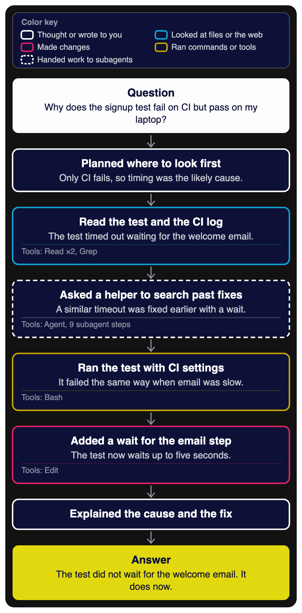

# thinking-flow

A Claude Code mod that draws how Claude reached each answer. A pane beside the conversation shows your question, a few steps in plain words, and the answer.



*An example. The question and the steps are made up for this picture.*

## What the pane shows

Type `/thinking-flow` to open the pane. Every answer Claude finishes after that gets a flow, and the buttons under it move between answers.

A small model (Haiku) reads what the session showed during the answer and groups the work into two to six steps. Each step gets a short label and one line on what it found. The line at the bottom left of a box lists the tools that step used. **Show actions** lists the tool calls and thinking summaries behind every step, so you can check the wording against what happened.

The outline color says what kind of work a step did:

| Outline | Kind of work |
| --- | --- |
| White | Thought or wrote to you, with no tools |
| Cyan | Looked at files or the web |
| Hot pink | Made changes, such as edits or form entries |
| Gold | Ran commands or other tools |
| White, dashed | Handed work to subagents |

When a step did several kinds of work, the strongest one sets the color, in this order: changes, commands, subagents, looking, then writing or thinking. A pink outline therefore always means something changed. Tool calls you refused do not count, and updates to Claude's to-do list count as thinking. The question sits in a white card and the answer in a yellow one.

In a terminal session the pane shows the same flow as numbered lines.

## Install

Built and tested on Claude Code 2.1.293. Mods use an early-access API that can change between releases.

The mod works only in Claude Code. It draws in the terminal and in the Code tab of the Claude desktop app. It has no effect in claude.ai chat or in Cowork, and the chat panel of the VS Code extension shows nothing from it.

In a terminal session, run:

```
/plugin install thinking-flow --marketplace thunini/thinking-flow
```

Answer `y` to add the marketplace, then choose a scope. The user scope loads the mod in every session, including the Code tab of the Claude desktop app, which cannot run the install command itself.

The steps read better when Claude Code shows thinking summaries. To turn them on, add this line to `~/.claude/settings.json`:

```json
"showThinkingSummaries": true
```

Without it, the record holds tool calls and text only.

## What it sends, and what it costs

When an answer ends, the mod makes one request to Haiku through Claude Code's own model access, on the account your session already uses. The request holds:

- your message, cut to 700 characters
- for each step: the thinking summary as the session showed it (cut to 300 characters), up to eight tool calls with a short target (the last two parts of a file path, or a command, URL or search cut to 48 characters), and whether the step wrote text
- Claude's answer, cut to 700 characters

A record keeps at most 40 steps: the first 20 and the last 20. On three answers rebuilt from a real session, with 2 to 12 steps, the request was 1,369 to 3,461 characters (about 340 to 870 tokens) and the replies were 500 to 929 characters. The reply is capped at 800 tokens. The request counts toward your usage like any other Claude Code request.

Nothing else leaves the session. The mod writes no files and makes no other network calls. The record lives in the session's memory and ends with it. The only web address in the code is `http://www.w3.org/2000/svg`, the standard name every SVG drawing carries, and nothing ever fetches it.

To make no model calls at all, set **Step wording** to `rules`, either on the install screen or later in `/config`. Steps then get fixed labels such as "Looked at 3 sources".

## How the wording stays close to the record

The small model sees only what the session showed: thinking summaries, tool calls and the answer. Its reply is used only when its steps cover every step of the record exactly once and in order. Otherwise fixed rules group the steps, and the pane says why. The wording is still a summary written by a model, so **Show actions** is there to check it.

## Limits

- The figure is a picture. Use **Show actions** for the details behind a step.
- A flow appears a few seconds after its answer ends.
- Steps that subagents take are counted on the step that started them.
- A new session starts with an empty pane.

## Develop

```bash
claude plugin validate . --strict
claude plugin test .
```

The `types` field in `plugin.json` names the mod's state contract, `types/index.d.ts`. Claude Code's validator requires it for a mod that keeps state, so the field stays even though some checkers list it as unknown.

To run the mod from a folder, start Claude Code with `claude --plugin-dir <folder>`. Claude Code writes its type declarations into `.claude-plugin/types/` whenever it loads the folder, and after that a TypeScript compiler run, `tsc -p .`, type checks the mod.

## License

MIT. See [LICENSE](LICENSE).
